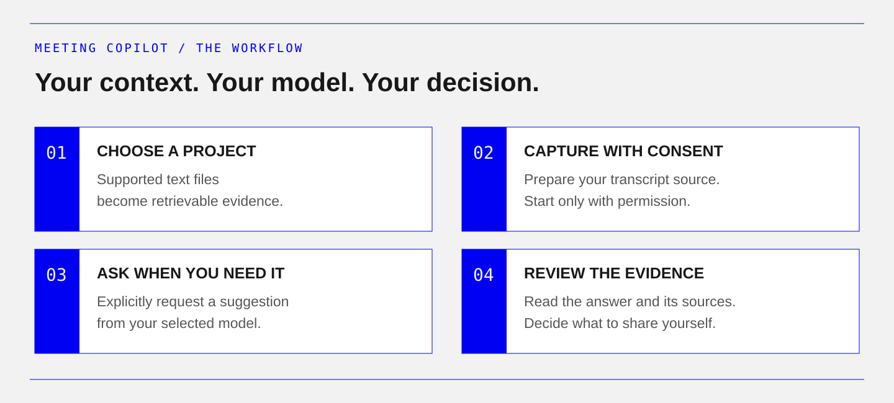
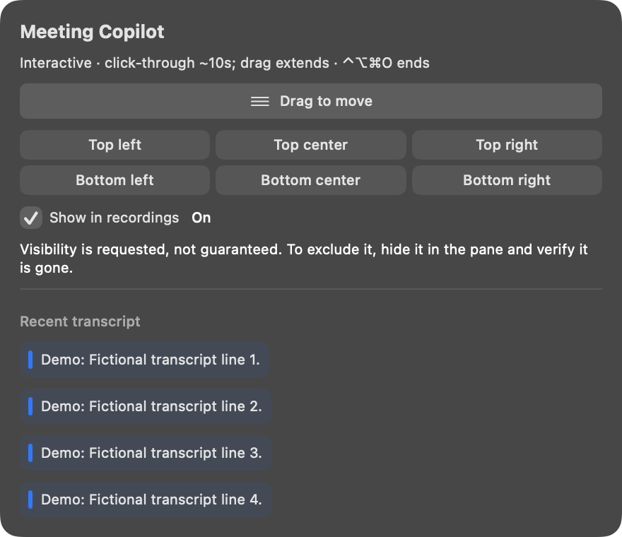
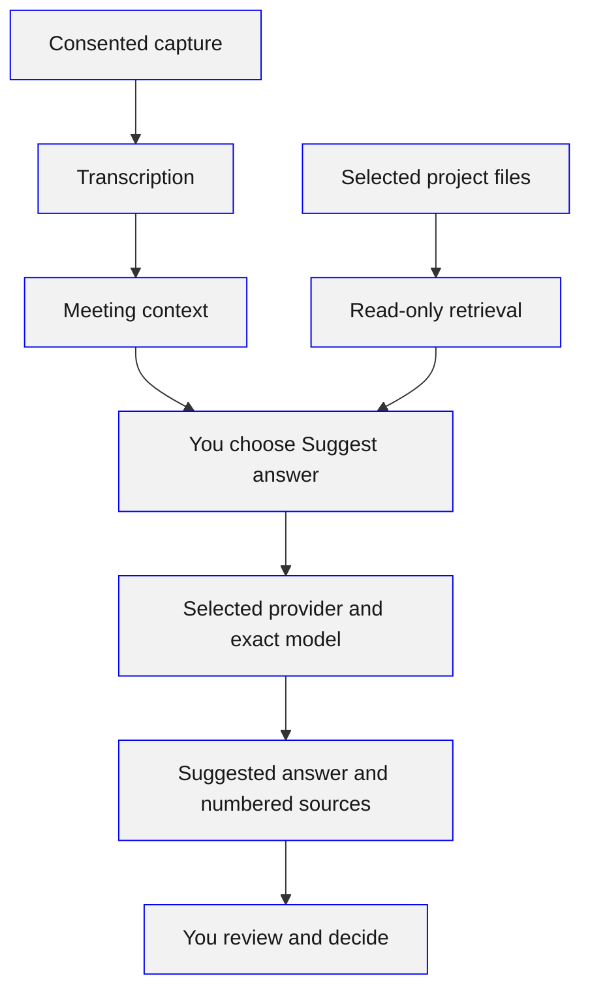

# Meeting Copilot

**Meeting answers grounded in your project files.**

A community plugin for Hermes Desktop by [Adam Nugroho](https://github.com/adam4788).
Capture a consented meeting, choose a project, and explicitly ask for a short
answer with numbered evidence sources. Read the suggestion and decide how to use
it. Nothing is spoken, posted, or submitted for you.


*Generated conceptual artwork; not a product screenshot.*

<p align="center">
  <a href="docs/getting-started.md"><strong>Get started →</strong></a> ·
  <a href="docs/demo.md">Try the offline demo</a> ·
  <a href="docs/README.md">Read the docs</a> ·
  <a href="SECURITY.md">Privacy &amp; control</a>
</p>

> **Early developer preview.** Capture is experimental; short tests and CI do not
> establish reliable long meetings or provider access on your machine.
> [See platform status and verification](#current-status).

## From conversation to a source-backed suggestion



| **Ground it** | **Ask deliberately** | **Keep control** |
| :--- | :--- | :--- |
| Select a project. Retrieve supported text files and inspect numbered sources. | Suggest an answer, catch up, extract actions, or suggest a question when you choose. | Review first. Nothing is automatically spoken, posted, or submitted. |

### See the native overlay

<p align="center">
  
</p>

*Native macOS 27 view rendered with synthetic content at source `32680e03`.
Not a live meeting or proof of recorder exclusion. [Asset provenance](docs/assets/README.md).*

The overlay is a read-only companion: one latest requested answer, with recent
context tucked away. Ask questions and review evidence in the Desktop pane.
Show the overlay, then ask in the pane. No extra model request is made by the
overlay. Recording visibility is best effort: hide the overlay when it must
not appear in a recording.

### Try it before connecting anything

The offline demo uses fictional project files and a fake provider. No API key,
audio device, or Hermes installation is required. From a source checkout:

```sh
python demo_standalone.py
```

[Follow the walkthrough](docs/demo.md) · [Install in Hermes Desktop](#install-in-hermes-desktop)

## What it does

<details>
<summary><strong>Explore capabilities and model options</strong></summary>


- Reads supported text files from a selected project and shows the evidence used
  for each answer. Markdown, plain text, and reStructuredText are supported.
- Uses local Whisper transcription, optional explicit Meta cloud transcription,
  a bounded [Google Gemini transcription preview](docs/google-transcription.md),
  or an optional, unofficial Meetily JSON attachment, depending on platform setup.
- Checks required capture settings and permissions before enabling Start, with
  separate explicit permission setup and model preparation. See [preflight](docs/preflight.md).
- Offers explicitly loaded answer model options for configured OpenAI/OpenRouter
  keys, with manual entry and clear account-access limits.
- Defaults new answer settings to **Follow Hermes default** on supported hosts,
  with host-owned credentials and routing. Saved explicit overrides remain.
- Sends an answer request through that default or the provider and exact model you select in
  **Settings → Plugins → Meeting Copilot**. OpenAI and OpenRouter are the main
  Desktop answer routes.
- Offers explicit recent-transcript actions: **Catch me up**, **Extract actions**,
  and **Suggest a question**. These use your selected model, not the whole meeting.
- Keeps past sessions excluded and web search off by default in new panes.
  Broader scopes are explicit choices; saved choices persist.
- Offers a read-only macOS overlay for the transcript and detected questions.
  Temporarily enable interaction to drag its header, choose a position preset,
  or turn **Show in recordings** on. Turning it off only requests best-effort
  exclusion; the overlay may still appear in captures. Hide it when it must not
  appear. Ask questions in the Desktop pane.

</details>

### How the pieces fit together



Capture, transcription, retrieval, and answer generation are separate steps.
Local transcription does not make hosted answers local.

## Install in Hermes Desktop

Requires **Hermes 0.22.7 or newer**. The macOS developer-preview catalog entry
[was merged](https://github.com/NousResearch/hermes-agent/pull/152088). Catalog
admission does not establish live capture or provider readiness.
Use a full 40-character commit from the reviewed
[runtime-release branch](https://github.com/adam4788/meeting-copilot/tree/catalog/runtime-0.1.0),
not a floating branch or the development tree. Copy its full SHA before running:

```sh
# Replace the quoted placeholder with the runtime commit you reviewed.
PIN="REVIEWED_40_CHARACTER_RUNTIME_SHA"
hermes plugins install adam4788/meeting-copilot --ref "$PIN" --no-enable
hermes plugins enable meeting-copilot-live
hermes plugins doctor meeting-copilot-live --ci
```

The catalog command `hermes plugins install
meeting-copilot-live --no-enable` uses the catalog’s reviewed pin, which may differ
from the latest source on `main`. This repository does not
self-update the catalog or bypass installation consent.

Open the command palette and run **Open Meeting Copilot**. Agent enablement and
the Desktop Plugins switch are separate; check both for the intended profile.
Audio preparation is separate. Its reviewed wheel lock targets Apple Silicon
and CPython 3.12; setup verifies SHA-256 hashes from official PyPI and builds the
native helpers from source. Catalog-generated files stay outside the pinned
checkout in version-bound profile storage; rerun preparation after updating.
Installation and doctor do not start recording or verify a live provider. See
[the setup guide](docs/getting-started.md).

Review scanner findings for the exact pin before continuing. A reloaded pane
is not provider or audio readiness. Windows capture remains experimental.

## Ask your first question

New panes use **Follow Hermes default** when this runtime has a genuine,
profile-scoped host route. No separate plugin answer key is needed for that mode.
Existing provider choices stay unchanged. If the default route is unavailable
or you want an override, use the OpenAI/OpenRouter setup below. See
[default-route limits](docs/preflight.md#follow-the-hermes-default).

1. In **Settings → Plugins → Meeting Copilot**, open the plugin's agent settings
   for the default profile and save an OpenAI or OpenRouter key in its secret
   field. Reopen the pane; never put keys in chat or model fields.
2. From the pane, use **Open settings** (or navigate to **Settings → Plugins →
   Meeting Copilot**). Choose the matching answer provider and exact model ID,
   and select a transcript source and audio/transcription defaults if needed.
   Older Desktop hosts without plugin settings pages keep these controls in the pane.
   With no saved source choice, the pane selects the local macOS or experimental
   Windows capture route when backend capabilities identify the platform. Both
   microphone and system audio and local transcription are the defaults unless
   separately saved choices say otherwise. An unknown platform needs an explicit
   source choice; saved choices are retained.
3. In settings, select one project, keep **Exclude past sessions** checked and
   automatic web fallback off. Keep the pane's specific public web query empty.
4. Type a question about a synthetic project file and choose **Suggest answer**.
   Open **Evidence** and compare the answer with its sources.
5. To add meeting context, prepare the platform's transcript source, select any
   active Meetily recording in the pane, confirm participant permission, and
   pass the required preflight checks, and explicitly start capture. Use
   **Request macOS permissions…** for first-use OS access and the model-preparation
   command shown by a missing-model check. Pause when finished and check that stopping is
   confirmed. After changing capture settings, confirm permission again.

Start with [the synthetic walkthrough](docs/demo.md). It also includes an offline CLI
demo that needs no API key, audio device, or Hermes installation.

## Privacy and control

**Read-only project access. Explicit capture. Model calls only when requested.**
Local transcription does not make hosted answers local. Cloud transcription and
hosted answers send selected data off-device; review the boundaries before use.

<details>
<summary><strong>Read the full data-flow and consent boundaries</strong></summary>


Answer requests send the question, bounded meeting context, and retrieved
excerpts to the selected HTTPS provider. Provider billing and retention rules
apply. Optional Meta transcription also sends meeting audio off-device; local
Whisper may download model weights during preparation.

Project retrieval can read files outside plugin storage. Session history is
read only when enabled. Web opt-in sends a public query through Hermes search;
query filtering is best effort. Select only sources you may send to the chosen
provider and review evidence before sharing an answer.

Capture requires consent and Start. No extra raw audio or transcript files are
saved by this plugin; Meetily retains its own files under its own settings.
Closing the pane initiates pause, and an in-flight provider request cannot be
recalled. Check stop status instead of assuming the device has stopped.

Registering the plugin starts no workers. After explicit Start/Show, capture,
transcription and the overlay run as child processes. macOS preparation installs
declared Python packages into an isolated audio environment and compiles/signs
reviewable Swift source. It requires a preinstalled Python 3.12, uv and a macOS 26
SDK; automatic interpreter downloads are disabled. Model preparation may fetch
Whisper weights. No compiled helper or self-updater is shipped.

API keys stay in Hermes-managed secret settings and are read only in the
admitted request's bound scope. The plugin does not read or rewrite credential
stores. The standalone CLI is offline-only. There is no telemetry or automatic
sending, speaking, posting, capture or cloud-transcription opt-in.

Read [security and privacy](SECURITY.md) and the
[architecture and data flow](docs/architecture.md) for the complete boundaries.

</details>

## Current status

**Early developer preview.** The published source includes OpenAI/OpenRouter
bring-your-own-key setup. Live responses from those accounts remain unverified.
Native audio remains experimental. Recent local Mac checks recovered microphone
transcription and removed observed drops in short tests. System-audio capture is
still setup-dependent; a synthetic replay is not proof of a complete live meeting.
Windows Desktop pane and runtime verification is still in progress.

| Platform | Source CI checkpoint (c5aa3cf) | Desktop and native audio status |
| --- | --- | --- |
| Windows | Python 3.11/3.12 suite and JavaScript checks passed in CI | Desktop pane/runtime under verification; SoundCard/WASAPI capture remains experimental |
| macOS | Python 3.12 suite, JavaScript checks, and overlay helper build/self-test passed in CI | Historical checkpoint; see the newer bounded Mac/synthetic evidence below |
| Linux | Python 3.11/3.12 suite and JavaScript checks passed in CI | Native audio and Desktop use are not established by these checks |

The CI results above describe source revision
[`c5aa3cf`](https://github.com/adam4788/meeting-copilot/commit/c5aa3cf85bd94ce7134925d0ebc0c1c5a17c9f12)
([successful run](https://github.com/adam4788/meeting-copilot/actions/runs/42535380563)).
See [CI](https://github.com/adam4788/meeting-copilot/actions),
[verification notes](docs/verification.md), and the
[native loss investigation](docs/native-backpressure.md).
CI and plugin validation do not prove a complete meeting works on your computer.

A newer local preview at `0747967` transcribed a 38.4-second generated fictional
meeting with local Whisper and the explicit Google preview. Google matched all
119 normalized reference words; local `tiny.en` had one insertion (0.84% WER).
This is one controlled example, not a general accuracy benchmark, speaker
diarization result or live system-audio claim. See [verification](docs/verification.md#bounded-mac-and-generated-audio-checkpoint-0747967).
The runtime/catalog release must be pinned and validated separately.

## Known limits

- Native Windows Start is blocked until safe device/privacy readiness can be
  verified. Use an active Meetily recording; dependencies alone are not enough.

- Native capture can lose audio under load. Long meetings, broad device
  compatibility, and multi-speaker accuracy are not established.
- OpenAI/OpenRouter access, credits, exact model IDs, and API compatibility
  depend on the account. BYOK overrides have no automatic provider/model fallback;
  Follow Hermes default uses Hermes’ own routing/fallback policy.
- Sources are evidence supplied to a model, not proof of every generated claim.
  Missing or adversarial evidence can still produce an incorrect answer.
- PDF, DOCX, and XLSX extraction is not implemented. Project scans and session
  reads are bounded; this is not a search of the whole computer.
- Optional web search depends on a registered, profile-scoped Hermes tool and
  may be unavailable. The inspected isolated plugin-host route did not pass
  the request scope needed for BYOK; see [compatibility cautions](docs/catalog-compatibility.md).

## Explore the repository

| Goal | Guide |
| --- | --- |
| Set up providers, project scope, and audio | [Getting started](docs/getting-started.md) |
| Run a synthetic demonstration | [Demo guide](docs/demo.md) |
| Understand keys and model boundaries | [BYOK](docs/byok.md) |
| Understand retrieval and source limits | [Knowledge engine](docs/knowledge.md) |
| Work on the code or run tests | [Development](docs/development.md) and [contributing](CONTRIBUTING.md) |
| Review catalog packaging and disclosures | [Catalog preflight](docs/catalog-readiness.md) |
| Use the visual direction and assets | [Project brand guide](docs/brand-guide.md) |

Meeting Copilot is an independent community project. It is not an official Nous
Research product and is not endorsed by Nous Research. Code is licensed under
[MIT](LICENSE).

### Portable evidence

In the answer pane, **Copy answer + evidence** copies a plain-text report only
when you confirm. It includes the displayed answer, reported model route,
warnings, and numbered source excerpts (up to 2,050 Unicode characters per
source), so colleagues can inspect the basis for a suggestion. Source-update dates are not
meeting timestamps; source numbers identify retrieved documents, not meeting
segments. It is not a complete transcript or independently verified
meeting record. The copy does not send a new model request and excludes the
retained request snapshot and live transcript. Review confidential snippets and
links before sharing; clipboard history or device sync may retain the copy.
### Frozen transcript context

Answers based on live segments retain the exact bounded, sanitized transcript
context sent to the model, even after transcript corrections. Inspect its
per-answer excerpts in **Transcript context sent with this answer**. Backend
times remain uninterpreted, and references are not proof that a model claim is
correct. A separate **Copy sent transcript context** action requires confirmation;
ordinary evidence export excludes it. See [transcript context](docs/transcript-context.md)
for retry, retention, timing and verification limits.
## Reviewed meeting notes

Turn useful answers into an editable, review-first handoff with [Review notes](docs/review-notes.md). Notes stay in pane memory until you explicitly copy them; no automatic sharing or extra model call.
