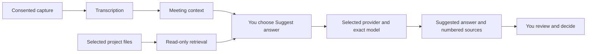

# Meeting Copilot

**Meeting answers grounded in your project files.**

A community plugin for Hermes Desktop by [Adam Nugroho](https://github.com/adam4788).
Capture a consented meeting, choose a project, and explicitly ask for a short
answer with numbered evidence sources. Read the suggestion and decide how to use
it. Nothing is spoken, posted, or submitted for you.

<!-- Visual integration pending: supplied generated conceptual hero art.
     Inspect the image and verify local bytes before adding its image reference.
     It must be labelled as generated artwork, not a product screenshot. -->

[Get started](docs/getting-started.md) · [Try the offline demo](DEMO.md) ·
[Privacy](SECURITY.md) · [Documentation](docs/README.md)

## Current status

**Early developer preview.** The published source includes OpenAI/OpenRouter
bring-your-own-key setup. Live responses from those accounts remain unverified.
Native audio is experimental; macOS fictional-audio checks found dropped frames.
Windows Desktop installation is still being checked separately from CI.

| Platform | Automated checks at the pinned revision | Desktop and native audio status |
| --- | --- | --- |
| Windows | Python 3.11/3.12 suite and JavaScript checks passed in CI | Desktop setup under verification; SoundCard/WASAPI capture remains experimental |
| macOS | Python 3.12 suite, JavaScript checks, and overlay helper build/self-test passed in CI | Microphone/system-audio checks used fictional content; native frame loss remains unresolved |
| Linux | Python 3.11/3.12 suite and JavaScript checks passed in CI | Native audio and Desktop use are not established by these checks |

This status describes source revision
[`b1e9089`](https://github.com/adam4788/meeting-copilot/commit/b1e9089eef0d55da3c724306b13e5d4479a1eef0).
See [CI](https://github.com/adam4788/meeting-copilot/actions),
[verification notes](docs/verification.md), and the
[native loss investigation](docs/native-backpressure.md).
CI and plugin validation do not prove a complete meeting works on your computer.

## What it does

- Reads supported text files from a selected project and shows the evidence used
  for each answer. Markdown, plain text, and reStructuredText are supported.
- Uses local Whisper transcription, optional explicit Meta cloud transcription,
  or an optional, unofficial Meetily JSON attachment, depending on platform setup.
- Sends an answer request to the provider and exact model you select in
  **Answer setup**. OpenAI and OpenRouter are the main Desktop answer routes.
- Keeps past sessions excluded and web search off by default in new panes.
  Broader scopes are explicit choices; saved choices persist.
- Offers a macOS meeting overlay. It may appear in screen shares.



Capture, transcription, retrieval, and answer generation are separate steps.
Local transcription does not make hosted answers local.

## Install in Hermes Desktop

Requires **Hermes 0.22.7 or newer**. Install the published source at a full revision:

```sh
hermes plugins install adam4788/meeting-copilot --ref b1e9089eef0d55da3c724306b13e5d4479a1eef0 --enable
hermes plugins doctor meeting-copilot-live --ci
```

Open the command palette and run **Open Meeting Copilot**. Audio preparation is
separate and platform-specific; installation and doctor do not start recording
or verify a live provider. See [the setup guide](docs/getting-started.md) before
enabling capture. Catalog admission has not been established; this is a managed
Git installation of a community project.

At the 2026-11-05 Windows checkpoint, Hermes stopped the pinned upgrade for scanner
review; this revision has not been installed there. Review findings before
continuing. Do not treat an older enabled custom installation as this build.

## Ask your first question

1. Configure an OpenAI or OpenRouter API key in the secret field for
   **meeting-copilot-live** in Hermes plugin settings, then save and reopen the
   pane. Never put keys in chat or model fields.
2. Open **Answer setup**, choose the matching provider, and enter an exact model
   ID supported by your account's Chat Completions API.
3. Select one project. Keep **Exclude past sessions** checked, automatic web
   fallback off, and the specific public web query empty.
4. Type a question about a synthetic project file and choose **Suggest answer**.
   Open **Evidence** and compare the answer with its sources.
5. To add meeting context, prepare the platform's transcript source, confirm
   participant permission, and explicitly start capture. Pause when finished
   and check that stopping is confirmed.

Start with [the synthetic walkthrough](DEMO.md). It also includes an offline CLI
demo that needs no API key, audio device, or Hermes installation.

## Privacy and control

Answer requests send the question, bounded meeting context, and retrieved
excerpts to the selected HTTPS provider. Provider billing and retention rules
apply. Optional Meta transcription also sends meeting audio off-device; local
Whisper may download model weights during preparation.

Project retrieval can read files outside plugin storage. Session history is
read only when enabled. Web opt-in sends a public query through Hermes search;
query filtering is best effort. Select only sources you may send to the chosen
provider and review evidence before sharing an answer.

Capture requires consent and Start. No extra raw audio or transcript files are
saved by this plugin; Meetily retains its own files under its own settings.
Closing the pane initiates pause, and an in-flight provider request cannot be
recalled. Check stop status instead of assuming the device has stopped.

Read [security and privacy](SECURITY.md) and the
[architecture and data flow](docs/architecture.md) for the complete boundaries.

## Known limits

- Native capture can lose audio under load. Long meetings, broad device
  compatibility, and multi-speaker accuracy are not established.
- OpenAI/OpenRouter access, credits, exact model IDs, and API compatibility
  depend on the account. There is no automatic provider/model fallback.
- Sources are evidence supplied to a model, not proof of every generated claim.
  Missing or adversarial evidence can still produce an incorrect answer.
- PDF, DOCX, and XLSX extraction is not implemented. Project scans and session
  reads are bounded; this is not a search of the whole computer.
- Two dashboard search/scope integrations still depend on private Hermes APIs.
  Review the [version compatibility cautions](docs/catalog-compatibility.md).

## Explore the repository

| Goal | Guide |
| --- | --- |
| Set up providers, project scope, and audio | [Getting started](docs/getting-started.md) |
| Run a synthetic demonstration | [Demo guide](DEMO.md) |
| Understand keys and model boundaries | [BYOK](docs/byok.md) |
| Understand retrieval and source limits | [Knowledge engine](KNOWLEDGE.md) |
| Work on the code or run tests | [Development](docs/development.md) and [contributing](CONTRIBUTING.md) |
| Review catalog packaging and disclosures | [Catalog preflight](docs/catalog-readiness.md) |
| Use the visual direction and assets | [Project brand guide](docs/brand-guide.md) |

Meeting Copilot is an independent community project. It is not an official Nous
Research product and is not endorsed by Nous Research. Code is licensed under
[MIT](LICENSE).
