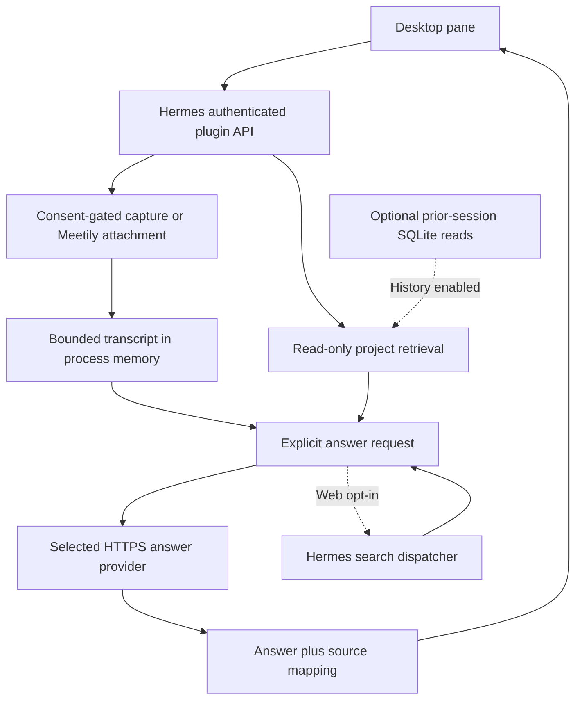

# Architecture and data flow

Meeting Copilot has a Desktop pane, an authenticated Hermes dashboard API,
a retrieval engine, and optional capture/overlay workers. Importing or
registering the plugin does not start recording.

## Components

| Area | Source | Responsibility |
| --- | --- | --- |
| Desktop | `desktop/plugin.js` | Consent, scope, answer controls, evidence, recovery status |
| API | `dashboard/plugin_api.py`, `server.py` | Host integration, meeting state, request lifecycle, bounded buffers |
| Retrieval | `knowledge.py`, `answer_core.py` | Project/session evidence, ranking, prompts, injectable standalone boundary |
| Answers | `byok.py`, `model_selection.py` | Explicit provider/model routing; optional Meta integration is separate |
| Capture | `audio.py`, `macos_audio.py`, `audio_worker.py`, `native/` | Platform capture, transcription workers, macOS helpers |
| Meetily | `meetily.py` | Read-only attachment to a selected recording's JSON snapshots |
| Overlay | `overlay_bridge.py`, `native/macos_overlay.swift` | Optional macOS display and explicit question actions |

`AnswerCore` can run independently with an injected completion function, disabled
search, and no history. The synthetic CLI demo uses that boundary, separately
from hosted Desktop credentials.

## What stays local and what leaves

| Step | Data and destination |
| --- | --- |
| Local transcription | Audio is processed by local Whisper after explicit Start. Model preparation may download weights. |
| Optional cloud transcription | The explicitly selected Meta transcription route sends audio to Meta. |
| Project retrieval | Reads eligible text from selected directories outside plugin storage; an in-memory index ranks bounded excerpts. |
| Optional session retrieval | Reads eligible past Hermes messages through read-only SQLite when history is enabled. Prior assistant claims remain unverified. |
| Answer generation | Sends the question, bounded transcript, and retrieved excerpts to the selected HTTPS provider. Local transcription does not change this boundary. |
| Optional web | Sends an explicit public query, or an opted-in model-drafted generic query after best-effort filtering, through the host search dispatcher. |

The plugin saves no extra raw audio or transcript files. Meetily controls its
own recordings and retention. Plugin transcript/results are bounded process
memory, not a durable archive. Provider retention and billing apply to submissions.

## Control and trust

The answer model receives no tools or permission to speak, post messages, or
write business-system records. Evidence is untrusted. Citations do not guarantee
correctness, and filtering cannot guarantee all sensitive text is removed.

Hermes owns plugin secrets. Production code obtains bound scoped settings and
does not edit credential stores. Standalone CLI BYOK explicitly uses process
environment credentials. Pause, Clear, or key changes cannot recall a submitted
provider request.

Capture/overlay use child processes; setup may install dependencies and
compile/sign helpers. A visible stopping state means shutdown is not confirmed.
See [security](../SECURITY.md), [BYOK](byok.md), and
[audio backpressure](native-backpressure.md).

Dashboard web search and fresh copied action scopes still use version-sensitive
private Hermes APIs. Missing/incompatible scopes fail closed. See
[compatibility review](catalog-compatibility.md) for the remaining seams.
